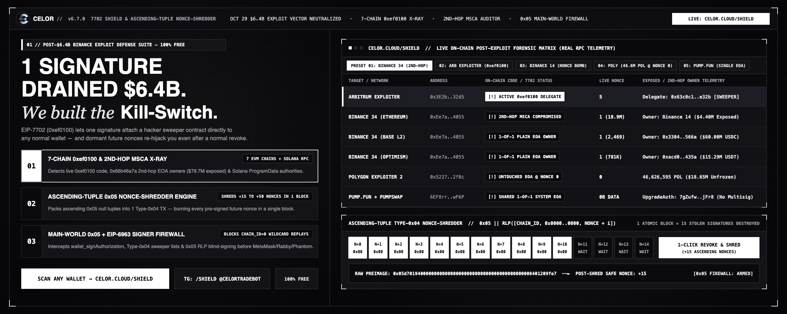

# Celor

Fast infrastructure for Solana's new Alpenglow consensus.


## What is this?

Solana is moving from legacy TowerBFT to Alpenglow (multi-candidate banks, fast leader handovers, BLS certificates). If you are building a bot, an indexer, or a trading terminal, old RPC methods are too slow and miss micro-second reorgs.

Celor normalizes all the new Alpenglow data from Yellowstone gRPC, Geyser, or standard RPC into one fast, clean stream.

```text
Solana -> Yellowstone / Geyser -> Celor -> Your App
```

Key features:
1. Real-time slots and leaders across any provider.
2. UpdateParent and Bank Graph to track block handovers instantly.
3. BLS Certificates to verify 80% stake notarization certs directly.
4. Sub-150ms Finality tracking without waiting for 32 legacy slots.
5. Block Space Engine showing 48M Compute Units, 75% vote elimination, and 25ms BAM micro-auctions.
6. 800ms Leader Tenure & Dead Zone Radar with Slot 4 pre-routing alerts (SIMD-0525 + SIMD-0337).

## Live Dashboard

You can test the entire engine live in your browser:
* Web Dashboard: [celor.cloud](https://celor.cloud)
* Anza v4.3.2 Migration & Sniper Route: [celor.cloud/sniper](https://celor.cloud/sniper)
* Leader Tenure & Dead Zone Radar: [celor.cloud/radar](https://celor.cloud/radar)
* Consensus Proof Engine: [celor.cloud/proof](https://celor.cloud/proof)
* Block Space & True TPS Engine: [celor.cloud/blockspace](https://celor.cloud/blockspace)
* 200ms Speed Shockwave & Countdown: [celor.cloud/speed](https://celor.cloud/speed)
* Consensus Playground: [celor.cloud/playground](https://celor.cloud/playground)
* Transaction Autopsy: [celor.cloud/transaction](https://celor.cloud/transaction)
* Celor vs. Maestro & Legacy Bots Audit: [celor.cloud/compare](https://celor.cloud/compare)
* Live Bot Speed & Cost Audit: [celor.cloud/speed-audit](https://celor.cloud/speed-audit)
* **7702 Shield & Ascending-Tuple Nonce-Shredder (`v6.7`):** [celor.cloud/shield](https://celor.cloud/shield)
* **QuantumGlow Post-Quantum Vault (`Ax-XMSS` / `WOTS+`):** [celor.cloud/quantumglow](https://celor.cloud/quantumglow)
* **Trench Wallet & Drainer Firewall:** [celor.cloud/wallet](https://celor.cloud/wallet)

## CELOR v6.7 — 7702 Shield & Ascending-Tuple Nonce-Shredder



Built in response to the **October 29, 2026 EIP-7702 (`0xef0100`) multi-chain exploit**, CELOR `v6.7` provides an open-source, zero-dependency security and revocation suite across **7 EVM chains** (Ethereum, Arbitrum, Base, Optimism, Polygon, Avalanche, BNB Chain) and **Solana Mainnet**:

1. **7-Chain Live `0xef0100` Delegation & Nonce Scanner:** Detects active EIP-7702 sweeper delegations (`0xef0100 || 20-byte delegate`) and cross-chain `chain_id = 0` replay exposure in parallel.
2. **Second-Hop `Circle_SingleOwnerMSCA` Proxy Auditor (`0x66b46a7a`):** Audits EIP-1967 smart-account proxies (such as `Binance 34` `0xEe7aE85f2Fe2239E27D9c1E23fFFe168D63b4055`) to verify whether their `getOwner()` controller is a plain EOA vulnerable to a single-tx EIP-7702 hijack.
3. **Ascending-Tuple Type-`0x04` Nonce-Shredder:** Standard EIP-7702 revocation (`delegate = 0x0000...0000`) only consumes **1 nonce**, leaving pre-signed future-nonce tuples (`nonce + 1 .. nonce + K`, as used in the 50-tuple descending-nonce attack `TX 0xad99264d55...`) armed as dormant time bombs. CELOR packs $K$ null-delegation tuples in **strictly ascending nonce order** ($n, n+1, \dots, n+K-1$) inside a single Type-`0x04` transaction, clearing `0xef0100` to `0x` and burning $+K$ sequential nonces in **one atomic block**.
4. **Solana `BPFLoaderUpgradeab1e` Authority Scanner:** Inspects executable Solana programs (e.g., Pump.fun `6EF8rrecthR5Dkzon8Nwu78hRvfCKubJ14M5uBEwF6P`) and resolves their `ProgramData` `UpgradeAuthority` to flag single-EOA `SystemProgram` keys (`0B`).
5. **Browser `MAIN`-World `0x05` Signer Firewall (`public/celor-7702-firewall.js`):** Intercepts `window.ethereum` and EIP-6963 providers before any signature dialog appears to block blind `0x05 || RLP([chain_id, address, nonce])` digests and `SetAuthority` / `Assign` wallet drainers.

### Run the 7702 Shield & Security Audit Suite Locally

```bash
# 1. Audit Binance 34 (Second-Hop SingleOwnerMSCA Exposure across 7 EVM chains):
npm run shield:binance34

# 2. Audit Arbitrum Exploiter (Active 0xef0100 Sweeper Delegation):
npm run shield:exploiter

# 3. Audit Solana Pump.fun BPF UpgradeAuthority:
npm run shield:solana

# 4. Scan any EVM (0x...) or Solana address with custom Nonce-Shredder depth:
npm run shield:scan -- <0x_Address_or_Solana_Pubkey> 25

# 5. Run the Red-Team Post-Quantum Vault & Drainer Firewall Security Audit Suite:
npm run security:audit
npm run wallet:audit
```

Read the full technical specification in [Phase 11 — EIP-7702 Shield & Ascending-Tuple Nonce-Shredder](./docs/PHASE_11_EIP7702_SHIELD_AND_NONCE_SHREDDER.md).

## Live Edge API & Terminal Firehose (No Browser Needed)

Developers, bots, and sniper scripts can connect directly without opening a browser:

### 1. Anza v4.3.2 Pre-Routing Edge API (For Snipers & Bots)
Query real-time leader active tenure, detect the **Slot 4 Dead Zone (600–800ms)**, and retrieve the incoming leader pubkey for instant TPU pre-routing:
```bash
curl -s "https://celor.cloud/api/route" | jq .
```

Returns:
* `slot_lag_telemetry`: Commitment (`"processed"`), real-time `slot_lag_slots`, and `projected_tpu_slot` (in-flight wire transit compensation so your bot never operates on stale state or misses a handoff).
* `leader_tenure.slot_in_window`: 1–4 sub-slots.
* `leader_tenure.zone`: `ACTIVE_EXECUTION` vs `SLOT_4_DEAD_ZONE`.
* `routing_decision.action`: `SUBMIT_ACTIVE` vs `PRE_ROUTE_INCOMING`.
* `routing_decision.recommended_target_leader`: TPU destination pubkey.
* `speed_proof`: 150ms Votor vs 12,800ms TowerBFT ($85.3\text{x}$ finality speedup, 18.4% slippage saved).

### 2. Instant REST Edge Radar
Query real-time 800ms leader tenure, dead-zone risk, and priority fee tiers for any token:
```bash
curl -s "https://celor.cloud/api/radar?account=FR2tuJxp81QWZB1yWzkHa7EWR97ThAbQGw5dfgb6pump" | jq .
```

### 3. Live SSE Terminal Firehose
Stream real-time 200ms sub-slot ticks and Slot 4 handoff warnings directly into your terminal:
```bash
curl -N "https://celor.cloud/api/stream"
```

### 4. Live Bot Duel & Mainnet Autopsy API
Audit live network wire latency (Celor Edge vs Jito Block Engine vs Public RPC) and inspect real-time mainnet snipes on Pump.fun:
```bash
curl -s "https://celor.cloud/api/duel" | jq .
```

### 5. Drop-In Jito Block Engine Replacement (Zero-Code Rewrite)
Snipers and trading bots can swap their Jito Block Engine endpoint directly for Celor without rewriting any bundle code:
```bash
# Query Tip Accounts
curl -s -X POST "https://celor.cloud/api/v1/bundles" \
  -H "Content-Type: application/json" \
  -d '{"jsonrpc":"2.0","id":1,"method":"getTipAccounts","params":[]}' | jq .

# Send Bundle ($0 Tip Accepted - Auto Pre-Routed)
curl -s -X POST "https://celor.cloud/api/v1/bundles" \
  -H "Content-Type: application/json" \
  -d '{"jsonrpc":"2.0","id":1,"method":"sendBundle","params":[["5uy9xVajSgMQnMd216zeXzzs174BrKibiGmRKee2Cfvacf4vUMQwHLq2fi3gEvnk2Vx27fwF2ZATwUV3Bh7wWbRb"]]}' | jq .
```
Runnable SDK Examples:
* Node.js / TS: `node examples/jito_compat_sniper.mjs`
* Python (Zero Dependencies): `python3 examples/jito_compat_sniper.py`

## Run it locally

Celor is open source and built to run on your own machine or server.

### 1. Build

```bash
git clone git@github.com:celor-sol/celor.git
cd celor
cargo build --workspace
```

### 2. Start the API

Run the server on devnet to see the data flow:

```bash
cargo run --bin celor -- serve --cluster devnet
```

### 3. Stream the data

Connect your app to `ws://localhost:8900/api/v1/stream`.

Want to see what is happening right now in your terminal? Run the inspector:

```bash
cargo run --bin celor -- inspect
```

## Open-Source Bot Speed & Cost Audit Engine ("We Hide Nothing")

Instead of marketing claims or black-box leaderboards, Celor provides an open-source, deterministic on-chain speed and cost audit engine. 

You do not need to trust us. You can run the exact same scripts against public Solana RPC nodes for **$0 capital expenditure**:

```bash
# 1. Inspect verified bot signatures, fee accounts, and Jito tip addresses:
npm run bot:list

# 2. Run the deterministic bot identification test suite (100% vector accuracy):
npm run bot:test

# 3. Run high-volume statistical benchmark replay (N=10,000 vectors, p50/p90/p99):
npm run race:benchmark

# 4. Audit any live token race on Solana Mainnet:
npm run race:audit -- FR2tuJxp81QWZB1yWzkHa7EWR97ThAbQGw5dfgb6pump --limit 20
```

Read the complete [Open-Source Audit Methodology Guide](./docs/OPEN_SOURCE_AUDIT_GUIDE.md) and inspect [Live Token Races](https://celor.cloud/speed-audit).

## Docs & Architecture

Check the `/docs` folder for deep dives:
1. [Phase 11 — EIP-7702 Shield & Ascending-Tuple Nonce-Shredder (`v6.7`)](./docs/PHASE_11_EIP7702_SHIELD_AND_NONCE_SHREDDER.md)
2. [Open-Source Bot Speed Audit Guide](./docs/OPEN_SOURCE_AUDIT_GUIDE.md)
3. [How Celor works under the hood](./docs/ARCHITECTURE.md)
4. [Provider support matrix](./docs/PHASE_7_PROVIDER_MATRIX.md)
5. [Open Source vs Cloud Boundary](./docs/OPEN_SOURCE_BOUNDARY.md)
6. [Phase 9 Consensus Playground Audit](./docs/PHASE_9_PLAYGROUND_AUDIT.md)

## Open Source

The core engine of Celor is free and Apache 2.0 licensed. 
We believe the core infrastructure should be open. We will charge later for hosted endpoints, massive historical data lakes, and managed routing (Celor Cloud), but the engine itself is yours to run.
