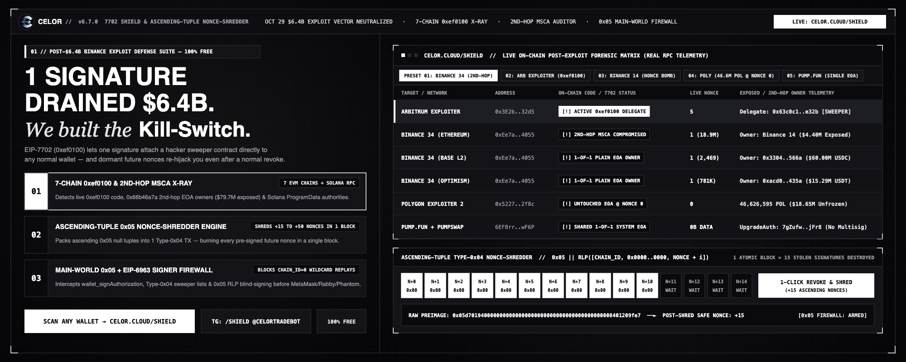

# Phase 11 — CELOR 7702 Shield & Ascending-Tuple Nonce-Shredder (`v6.7` Open-Source Release)

**Status:** Mainnet Live (`https://celor.cloud/shield/`) · Open-Source (MIT License)



---

## 1. Threat Model: The October 29, 2026 EIP-7702 Exploit Vector (`0xef0100`)

Under **EIP-7702** (Type-`0x04` Set Code transactions), any Externally Owned Account (EOA) can delegate execution control of its storage and token balances to an arbitrary smart contract by signing a single offline authorization tuple:

$$\text{Digest} = \text{keccak256}\Big(\texttt{0x05} \;\|\; \text{RLP}\big([\texttt{chain\_id},\; \texttt{address},\; \texttt{nonce}]\big)\Big)$$

### Three Critical Post-Exploit Hazards Discovered On-Chain

1. **The Dormant Future-Nonce Time Bomb (`TX 0xad99264d55...`):**
   - In TX `0xad99264d554a605e8de6a3dc822ac881167527c858b18298a1c6434b5c43bd1d` (Block `24,992,282`), the attacker packed **50 EIP-7702 tuples** in *descending* nonce order (`18,914,824` down to `18,914,775`) so the EVM would only execute the tuple matching the current nonce without consuming the rest.
   - Standard revocation (`address = 0x0000000000000000000000000000000000000000`) only consumes **1 nonce**. If an attacker holds pre-signed tuples for `nonce + 1 .. nonce + K` or a cross-chain wildcard tuple (`chain_id = 0`), they can re-hijack the wallet on a future block.
2. **The Second-Hop `Circle_SingleOwnerMSCA` Proxy Drain (`Binance 34` `0xEe7a...4055`):**
   - `Binance 34` (`0xEe7aE85f2Fe2239E27D9c1E23fFFe168D63b4055`) is an EIP-1967 proxy (`209B`) whose `getOwner()` (`0x66b46a7a`) points to a single EOA (`Binance 14` on Ethereum, `0x3304...566a` on Base guarding `$60M USDC`, and `0xacd0...435a` on Optimism guarding `$15.29M USDT`).
   - Because EIP-7702 executes inside the delegated EOA's context (`msg.sender == EOA`), hijacking the owner EOA via `0xef0100` allows a single transaction (`TX 0xdc102dd8...`) to drain the second-hop MSCA proxy without touching the proxy's own bytecode.
3. **Solana `BPFLoaderUpgradeab1e` Single-EOA Authorities:**
   - High-TVL Solana programs (including Pump.fun `6EF8rrecthR5Dkzon8Nwu78hRvfCKubJ14M5uBEwF6P` and PumpSwap `pAMMBay6oceH9fJKBRHGP5D4bD4sWpmSwMn52FMfXEA`) share a single `0B` `SystemProgram` EOA (`7gZufwwAo17y5kg8FMyJy2phgpvv9RSdzWtdXiWHjFr8`) as their `ProgramData` `UpgradeAuthority`.

---

## 2. The Solution: Ascending-Tuple Type-`0x04` Nonce-Shredder

By reversing the attacker's descending-nonce trick and packing $K$ tuples in **strictly ascending nonce order** ($n, n+1, n+2, \dots, n+K-1$) all delegating to `0x0000000000000000000000000000000000000000` inside a single Type-`0x04` transaction:

1. Tuple $0$ matches the EOA's current nonce $n$, clears any `0xef0100` code indicator to `0x`, and **increments the EOA's nonce to $n+1$ mid-transaction**.
2. Tuple $1$ immediately matches the newly incremented nonce $n+1$ and increments it to $n+2$.
3. All $K$ nonces are burned atomically in **one single block**, permanently invalidating any off-chain pre-signed future-nonce tuples in the range $[n, n+K-1]$.

---

## 3. Open-Source Components in This Repository

| File | Description |
| :--- | :--- |
| [`app/shield/page.tsx`](../app/shield/page.tsx) | Open-Source 7-Chain EVM + Solana `/shield` Web Terminal & Nonce-Shredder UI |
| [`functions/api/shield.ts`](../functions/api/shield.ts) | Open-Source Edge RPC Scanner (`eth_getCode`, `0xef0100`, `0x66b46a7a` Second-Hop MSCA Auditor & Solana `ProgramData` Inspector) |
| [`scripts/celor_7702_shield_cli.mjs`](../scripts/celor_7702_shield_cli.mjs) | Standalone Zero-Dependency Node.js CLI (`npm run shield:scan`) |
| [`public/celor-7702-firewall.js`](../public/celor-7702-firewall.js) | Standalone `MAIN`-World `0x05` & EIP-6963 Browser Signer Firewall |
| [`lib/wallet-backend/drainer_firewall.js`](../lib/wallet-backend/drainer_firewall.js) | Real-Time Solana & EVM Instruction-Level Drainer Firewall (`SetAuthority`, `Assign`, `Approve`, `0x05` RLP) |
| [`lib/wallet-backend/vault_crypto.js`](../lib/wallet-backend/vault_crypto.js) | QuantumGlow Post-Quantum `Ax-XMSS` / `WOTS+` Hash-Locked Vault Engine |
| [`scripts/stress_security_audit_v3.cjs`](../scripts/stress_security_audit_v3.cjs) | Automated Red-Team Security & Stress Audit Suite (`npm run security:audit`) |
| [`scripts/test_wallet_all_11_fixes.cjs`](../scripts/test_wallet_all_11_fixes.cjs) | 11-Vector Cryptographic Vault & Firewall Verification Suite (`npm run wallet:audit`) |

### Quick-Start CLI Usage

```bash
# Audit Binance 34 (Second-Hop SingleOwnerMSCA Exposure across 7 EVM chains)
node scripts/celor_7702_shield_cli.mjs 0xEe7aE85f2Fe2239E27D9c1E23fFFe168D63b4055 15

# Audit Arbitrum Exploiter (Active 0xef0100 Sweeper Delegation)
node scripts/celor_7702_shield_cli.mjs 0x3E2bf1ac6bf0934BBba6456C341c2EcbCED632d5 15

# Audit Solana Pump.fun BPF UpgradeAuthority
node scripts/celor_7702_shield_cli.mjs 6EF8rrecthR5Dkzon8Nwu78hRvfCKubJ14M5uBEwF6P
```
